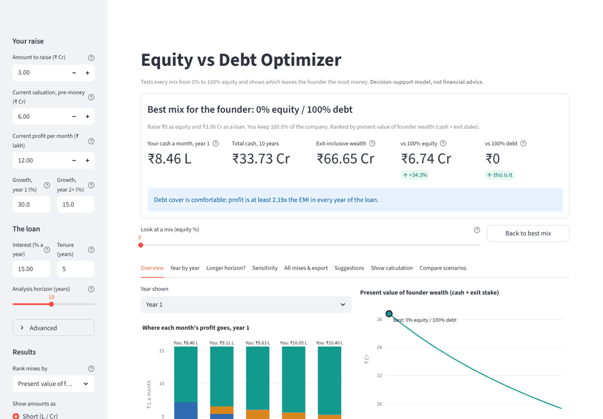
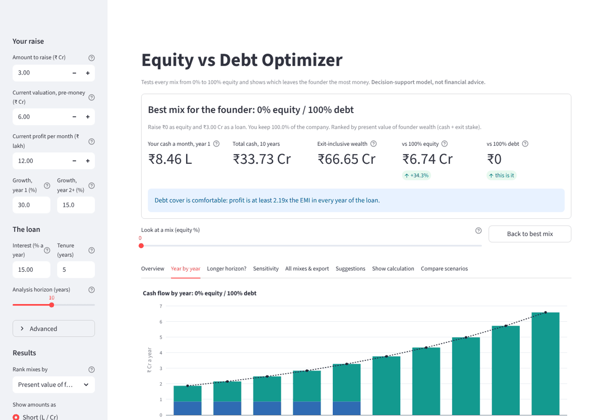
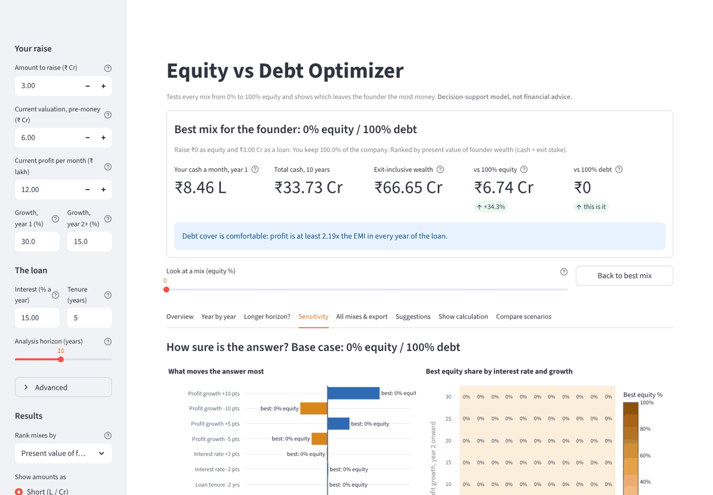
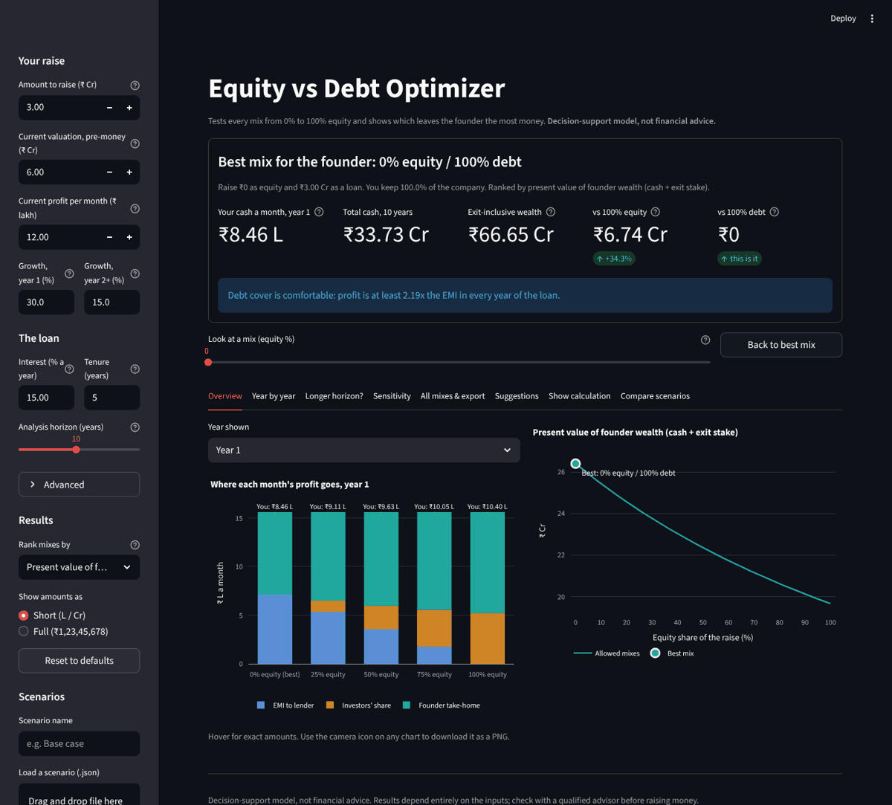

# Equity vs Debt Optimizer

A desktop app for founders raising money. It tests every mix from 0% to 100% equity (in 1% steps),
runs each one year by year over your chosen horizon, and shows which mix leaves **you, the founder,
with the most money**. It runs entirely on your computer: no server, no account, no internet after install.

> Decision-support model, not financial advice.



## Launch it

### The packaged app (no Python needed)

| Your computer | File | How to start |
|---|---|---|
| Windows | `EquityDebtOptimizer.exe` | Double-click. If SmartScreen warns about an unknown publisher, click **More info → Run anyway** (the app is not code-signed). |
| macOS | `EquityDebtOptimizer` | First time only, in Terminal: `chmod +x EquityDebtOptimizer` (the GitHub download drops the run permission). Then right-click → **Open** → **Open** (macOS blocks unsigned apps on a plain double-click). It opens in Terminal. |
| Linux | `EquityDebtOptimizer` | `chmod +x EquityDebtOptimizer && ./EquityDebtOptimizer` |

A small console window opens and your browser shows the app at `http://127.0.0.1:8501` (or the next free port).
The first start takes 5-15 seconds while the app unpacks. **Close the console window to quit.**
The app only listens on 127.0.0.1, so nothing is reachable from other computers.

**Where to get the file:** every push to this folder runs the GitHub workflow
`.github/workflows/optimizer-build.yml`, which tests and builds the app on Windows, macOS and Linux.
Open the repository's **Actions** tab → *Equity vs Debt Optimizer - test and build* → the latest run →
**Artifacts**, and download the one for your OS (it arrives zipped; unzip it first).

### From source (any OS with Python 3.11+)

```bash
cd optimizer
python -m venv .venv
.venv\Scripts\activate          # Windows
source .venv/bin/activate       # macOS / Linux
pip install -r requirements.txt
python launcher.py              # or: streamlit run app/ui.py
```

### Build the one-file app yourself

```bash
pip install -r requirements-dev.txt
python -m pytest                # 43 tests
python build.py                 # -> dist/EquityDebtOptimizer(.exe)
```

PyInstaller builds for the OS it runs on, so build on Windows for the `.exe` and on a Mac for the macOS file.
The file is about 125 MB because it carries its own Python, Streamlit and Plotly.

## Sample walkthrough

Start with the defaults: raise ₹3 Cr at a ₹6 Cr pre-money valuation, ₹12 lakh profit a month, growing 30% in
year 1 and 15% after, loan at 15% for 5 years, 10-year horizon.

1. **Headline:** best mix is **0% equity / 100% debt**. You take home **₹8.46 L a month** in year 1
   (₹15.60 L profit a month minus the ₹7,13,698 EMI). With 100% equity you would take home more in year 1
   (₹10.40 L, two-thirds of ₹15.60 L), but investors keep 33.3% of the company for good.
2. **Year by year** tab: the EMI stops after year 5, and from year 6 the 100% debt plan has put more cash in
   your pocket than 100% equity. That is the break-even year.
3. **Show calculation**: move the mix slider to 50%. Ownership is 1.5 / (6 + 1.5) = **20%**, not 33%, and the
   EMI on ₹1.5 Cr is **₹3,56,849**. Every step shows the formula and the numbers substituted in.
4. **Load `scenarios/tight-cash-flow.json`** (sidebar → *Load a scenario*): profit ₹7 lakh a month growing 8%,
   and you only accept a DSCR of 1.25 or more. Now the best mix is **16% equity / 84% debt**: the largest loan
   your cash flow can carry with that safety margin.
5. **Load `scenarios/early-short-horizon.json`**: a smaller, slower business looking only 4 years ahead with no
   exit value. Now **100% equity** wins, and 8 debt-heavy mixes are rejected because profit cannot pay the EMI.



## What the screens show

| Tab | What you get |
|---|---|
| Headline card | Best mix; your cash a month in year 1; total cash; exit-inclusive wealth; gain vs 100% equity and vs 100% debt; debt-cover warning |
| Overview | Stacked bars: where each month's profit goes (EMI, investors, you) for 0 / 25 / 50 / 75 / 100% equity and the best mix. Line: your outcome for every mix, best marked, rejected mixes hollow |
| Year by year | Profit, EMI, investor share and your share by year; cumulative cash for 100% equity, 100% debt, the best mix and the mix you pick; DSCR by year with 1.25 and 1.00 lines |
| Longer horizon? | Best mix and the gaps at 3, 5, 7, 10, 15 and 20 years, with a plain-language explanation |
| Sensitivity | Tornado (growth ±5 / ±10 pts, interest ±2 pts, valuation ±20%, tenure ±2 yrs) and a heatmap of best mix by interest rate and growth |
| All mixes & export | Sortable, filterable table of all 101 mixes; Excel (Indian number format), CSV and a PDF summary |
| Suggestions | Why this mix wins, risks, fundamentals (DSCR, tax shield, 51% / 26% control thresholds), a half-growth downside case |
| Show calculation | Every step for any mix with the numbers substituted, plus the full monthly loan schedule |
| Compare scenarios | Save / load scenarios as JSON and compare up to 3 side by side |

Every input has a **?** tooltip. Amounts can be shown in full (₹1,23,45,678) or short form (₹1.23 Cr, ₹12.00 L).
Light and dark mode follow your computer; switch from the **⋮** menu → **Settings**. Charts have a camera icon to
save a PNG.



## The model

For each equity share `e` from 0% to 100%:

| Step | Formula |
|---|---|
| Split | equity = amount × e; loan = amount × (1 − e) |
| Ownership (post-money) | investor % = equity / (pre-money + equity); founder % = 1 − investor % |
| EMI | P × r × (1 + r)^n / ((1 + r)^n − 1), r = annual rate / 12, n = months; at 0% interest P / n |
| Profit | year 1 = monthly profit × (1 + year-1 growth) × 12; later years × (1 + year-2+ growth) |
| Debt service | EMI each month during the tenure (split into interest and principal by the schedule), zero after |
| Tax (optional) | rate × (profit − interest); the tax saved because interest is deductible is the **tax shield** |
| Left after debt | profit − EMI − tax − one-time fees (year 1) |
| Cash out | payout % of what is left is distributed by ownership; the rest stays in the company |
| Founder cash | founder % × distributed; if profit cannot cover the EMI, the founder covers the gap |
| Exit stake | founder % × (exit multiple × final-year profit − loan still owed + cash kept in the company) |
| Present value | each year's cash ÷ (1 + discount rate)^year, plus the discounted exit stake |
| DSCR | profit ÷ EMI each year; below 1.25 is risky, below 1.00 cannot pay |

The best mix has the highest score among mixes whose DSCR never falls below 1.00 (or the higher minimum you set).
You can rank by present value of wealth (default), total cash, exit-inclusive wealth, or present value of cash.

**Why the answer is often 0% or 100%:** each extra rupee of equity dilutes you a little less than the one before,
so the founder's outcome curves upward towards one end. A mix in between wins when the loan has to be capped by
cash flow (the DSCR limit), or when you tell the model that debt and equity change growth differently.

**Assumptions to know:** profit growth is the same whichever way you fund (unless you set a growth boost); the
exit multiple applies to the final year's profit; dividends follow ownership exactly; there are no liquidation
preferences or later funding rounds.

## Project layout

```
optimizer/
  equity_debt/          calculation package, no UI code (pure Python + NumPy)
    model.py            inputs, validation, EMI, ownership, amortization, projection, optimizer
    analysis.py         horizon table, sensitivity, heatmap, downside, step-by-step explanation
    advice.py           plain-English suggestions written from the numbers
    formatting.py       Indian number formatting
    exports.py          Excel, CSV, PDF, scenario JSON
  app/
    ui.py               Streamlit screens
    charts.py           Plotly charts (debt blue, investors orange, founder teal everywhere)
  tests/                pytest (EMI, ownership, amortization, optimizer, formatting, exports)
  scenarios/            sample scenarios to load
  launcher.py           entry point for the packaged app
  build.py              PyInstaller build
```

All 101 mixes over 20 years compute in about 1 ms. The sensitivity and heatmap screens rerun the optimizer
about 80 times and still finish in well under a second.


